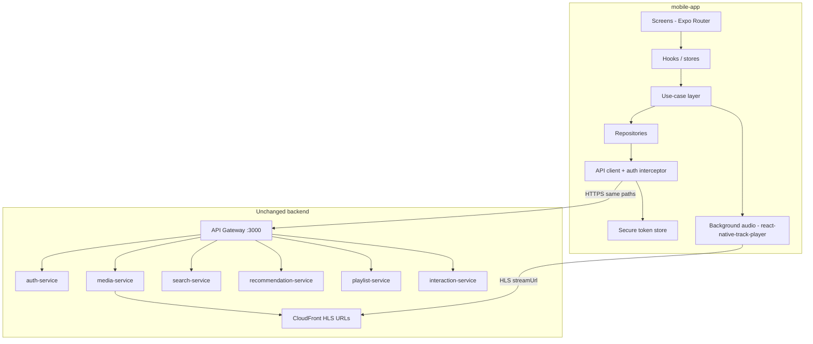

# Mobile frontend migration: Kotlin → React Native Expo

Migrate the Spotify Clone **frontend only** from `android-app/` to `mobile-app/`. **No backend changes.**

## Architecture



## Stack

| Concern | Choice |
|---------|--------|
| Framework | Expo SDK 52 + expo-dev-client |
| Navigation | Expo Router |
| API | fetch + typed DTOs |
| Server state | TanStack Query |
| Auth tokens | expo-secure-store |
| Playback | react-native-track-player + Zustand |
| Images | expo-image |

## Folder structure

```
mobile-app/
├── app/                    # Expo Router routes
├── src/
│   ├── api/
│   ├── types/
│   ├── repositories/
│   ├── use-cases/
│   ├── playback/
│   ├── storage/
│   └── components/
├── app.config.ts
└── .env.example
```

## API contract (gateway)

| Method | Path |
|--------|------|
| POST | `/auth/login` |
| POST | `/auth/register` |
| POST | `/auth/refresh` |
| GET | `/recommendations/for-you` |
| GET | `/recommendations/trending` |
| GET | `/search?q=&type=all&page=&size=` |
| GET | `/playlists/me?page=&size=` |
| GET | `/songs/{id}/stream` |
| POST | `/interactions/likes` |

## Environment

```
EXPO_PUBLIC_API_BASE_URL=http://10.0.2.2:3000   # Android emulator
# http://localhost:3000                         # iOS simulator
# http://192.168.x.x:3000                       # physical device
```

## Migration phases

1. Scaffold — Expo app, Router, env, API client
2. Auth — login/register/refresh; auth gate
3. Data screens — home, search, library
4. Playback — HLS stream + track-player + mini bar + player
5. Polish — like, queue from home, errors/loading
6. Deprecate — keep `android-app` as legacy reference

## Acceptance tests

- Register → login → home shows recommendation rows
- Search debounced; songs/artists/playlists sections
- Library lists playlists
- Play song → mini bar → full player → controls work
- Background playback + notification controls
- Token refresh after access token expires

## Implementation status

The Expo app lives in **`spotify-clone/mobile-app/`**. Run instructions: `mobile-app/README.md`.

The legacy Kotlin app remains in **`spotify-clone/android-app/`** (reference only).
